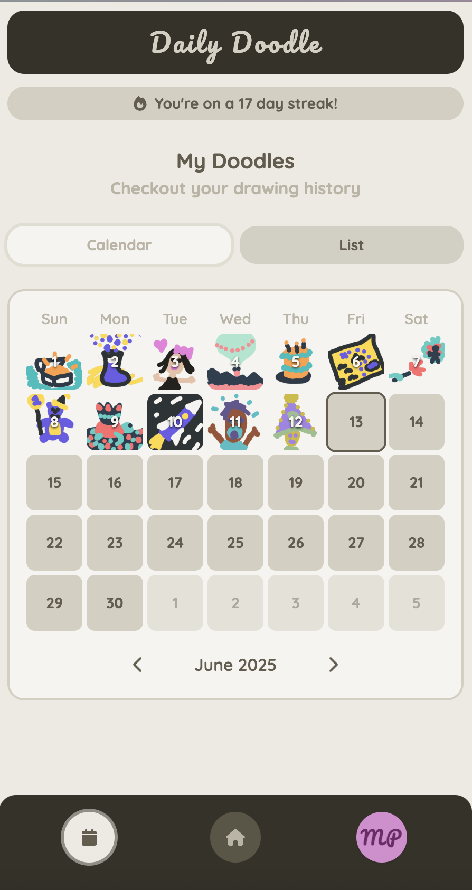

# Welcome to the Daily Doodle!



# Getting started

Auth is handled by [Clerk](https://clerk.com). Copy the env examples and fill in your Clerk Development instance keys:

```bash
cp .env.example .env.local          # VITE_CLERK_PUBLISHABLE_KEY
cp server/.env.example server/.env  # CLERK_SECRET_KEY (+ optional DEV_USER_EMAIL)
```

To run the backend (port 8080). In development it resets and reseeds a local SQLite `drawer.db` on every start:

```bash
cd server && go run ./cmd/drawer
```

To run the frontend (port 3000, proxies `/api` to the backend):

```bash
npm run dev
```

# Building for production

To build the docker image:

```bash
docker build --build-arg VITE_CLERK_PUBLISHABLE_KEY='pk_live_...' -t drawer-service .
```

To run the docker container:

```bash
docker run -p 8080:8080 -e TURSO_DATABASE_URL='' -e TURSO_AUTH_TOKEN='' -e CLERK_SECRET_KEY='' -e S3_BUCKET_NAME='' -e S3_BUCKET_REGION='' -e AWS_ACCESS_KEY_ID='' -e AWS_SECRET_ACCESS_KEY='' -e VAPID_PUBLIC_KEY='' -e VAPID_PRIVATE_KEY='' -e VAPID_SUBJECT='' -e ALLOWED_ORIGINS='' drawer-service
```

## Database schema

### Update database schema

Locally:

```bash
sqlite3 drawer.db < server/schema.sql
```

Turso:

```bash
turso db shell drawer-db < server/schema.sql
```

## Migrations

- Checkout Turso/Geni docs here: https://turso.tech/blog/database-migrations-with-geni

- To run on dev db:

```bash
DATABASE_URL="sqlite://./drawer.db" geni <COMMAND>
```

To create a migration

```bash
geni new this_cool_new_feature
```

### To apply all pending migrations

```bash
geni up
```

To rollback the last migration

```bash
geni down
```

Check migration status

````bash
geni status
``

### To rollback all migrations

Locally:

```bash
migrate -database "sqlite3://drawer.db" -path server/migrations down
````

Turso:

```bash
turso db migrate rollback drawer-db
```

## Styling

This project uses [Tailwind CSS](https://tailwindcss.com/) for styling.

## Linting & Formatting

This project uses [eslint](https://eslint.org/) and [prettier](https://prettier.io/) for linting and formatting. Eslint is configured using [tanstack/eslint-config](https://tanstack.com/config/latest/docs/eslint). The following scripts are available:

```bash
npm run lint
npm run format
npm run check
```

## Routing

This project uses [TanStack Router](https://tanstack.com/router). The initial setup is a code based router. Which means that the routes are defined in code (in the `./src/main.tsx` file). If you like you can also use a file based routing setup by following the [File Based Routing](https://tanstack.com/router/latest/docs/framework/react/guide/file-based-routing) guide.

## AI judges

Each new doodle can get a score and a short in-character comment from an AI judge (OpenAI). Set it up in **Admin → AI judges**: paste an OpenAI API key, pick a model (default `gpt-4.1`; it needs image input and structured outputs) and switch judging on. The key is stored server-side and never sent back to the browser; `OPENAI_API_KEY` on the backend works as a fallback.

- One judge is the **default**; a judge tied to an **event** takes over while that event runs.
- Every score is **out of 10**. A judge can score up to **3 criteria** (the overall score is then their average, to one decimal), or just one overall score.
- Every judge is told the game's limits (3 random colors a day, one thick brush, no text tool) and grades with them in mind. Words written on a doodle don't help it: the judge scores the drawing alone, and the overall score quietly loses 10% for a few words or 25% for mostly words (players aren't told; the testing ground shows it). A judge that can't tell what was drawn jokes about what it looks like instead.
- The **AI judges on** switch stops judging new doodles. Doodles drawn while it's off have no AI record and show no AI UI; reviews already written stay up.
- **Admin → Testing ground** runs one or more judges side by side on a past doodle or your own prompt and drawing, with unsaved prompt/criteria tweaks. Nothing there reaches players.
- **Admin → AI log** lists every judge run (real doodles, admin re-runs, tests), failures included, with totals. `OPENAI_BASE_URL` can point the judges at an OpenAI-compatible proxy.
- AI-only avatar decorations live in `src/ai/decorations.tsx`. Judge logic is in `server/internal/ai/`; another model provider only has to implement `ai.Provider`.

## Generating VAPID Keys for Push Notifications

To enable web push notifications, you need a VAPID public/private key pair. These are used to authenticate your server and encrypt push messages.

### 1. Install web-push globally (requires Node.js)

```sh
npm install -g web-push
```

### 2. Generate VAPID keys

```sh
web-push generate-vapid-keys
```

You will see output like:

```
Public Key:
BExxxxxxxxxxxxxxxxxxxxxxxxxxxxxxxxxxxxxxxxxxxxxxxxxxxxxxxx

Private Key:
8xxxxxxxxxxxxxxxxxxxxxxxxxxxxxxxxxxxxxxxxxxxxxxxxxxxxxxx
```

### 3. Usage

Set these on the **backend** only:

- `VAPID_PUBLIC_KEY` and `VAPID_PRIVATE_KEY`: the pair from step 2. The frontend fetches the public key from `/api/v1/notifications/vapid-public-key`, so the two can't drift apart.
- `VAPID_SUBJECT` (optional): a contact for the push services, either an email address or an `https://` URL. Defaults to `ALLOWED_ORIGINS`, which must then be `https://` in production; Apple rejects anything else.

Changing the key pair is safe: browsers re-subscribe with the new key the next time the user opens the app, and stale subscriptions are deleted when the push service reports them gone.

**Keep your private key secure and do not expose it to the frontend.**
